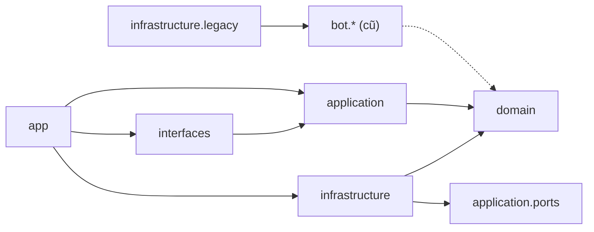

# Luật phụ thuộc

Ngày: 2026-11-21 · Trạng thái: **Đề xuất** · Liên quan: [ADR-0014](../adr/0014-luat-phu-thuoc-kiem-tra-tu-dong.md)

## 1. Luật

| # | Luật | Lý do |
|---|---|---|
| D1 | `aowbot.domain` không import `aowbot.application`, `aowbot.infrastructure`, `aowbot.interfaces`, `aowbot.app`, `bot`, `web`, `tools`, cũng không import `cv2`, `pytesseract`, `sqlite3`, `subprocess`, `flask`, `yaml`, `logging.handlers` | Luật nghiệp vụ phải test được tất định, không cần máy ảo |
| D2 | `aowbot.application` chỉ import `aowbot.domain` và thư viện chuẩn thuần; không import `infrastructure`, `interfaces`, `app`, `bot` | Use case phụ thuộc port, không phụ thuộc hiện thực |
| D3 | `aowbot.infrastructure` được import `domain`, `application.ports`, `bot`; **không** import `interfaces`, `app`, hay use case khác của `application` | Hạ tầng hiện thực port, không điều phối |
| D4 | Chỉ `aowbot.infrastructure.legacy` được import `bot.*` | Một cửa duy nhất vào mã cũ |
| D5 | `aowbot.interfaces` chỉ gọi use case `application` thông qua đối tượng được `app.composition` dựng sẵn; không import `infrastructure` | Giao diện không chứa logic, không tự dựng hạ tầng |
| D6 | `aowbot.app` là composition root duy nhất: nơi duy nhất gọi constructor của lớp hạ tầng | DI tường minh, không service locator |
| D7 | `bot`, `web`, `tools` chỉ được import `aowbot.domain` (khi tách hàm thuần), không import phần khác của `aowbot` | Tránh vòng giữa cũ và mới |
| D8 | Không có vòng import trong `aowbot` (mọi độ dài) | |
| D9 | Không có trạng thái toàn cục có thể thay đổi ở cấp module trong `aowbot` (trừ `logging.getLogger`) | Trạng thái phải có chủ sở hữu rõ ràng và do composition root truyền vào |
| D10 | Import đặt ở đầu file. Chỉ được import trong thân hàm khi có lý do ghi bằng comment (vd tránh nạp `cv2` chậm trong CLI) | Phụ thuộc phải nhìn thấy được |

## 2. Hướng phụ thuộc



## 3. Kiểm tra tự động

### 3.1 import-linter (cấu hình đề xuất trong `pyproject.toml`)
```toml
[tool.importlinter]
root_packages = ["aowbot", "bot", "web"]

[[tool.importlinter.contracts]]
name = "Phan lop aowbot"
type = "layers"
layers = ["aowbot.app", "aowbot.interfaces", "aowbot.infrastructure", "aowbot.application", "aowbot.domain"]

[[tool.importlinter.contracts]]
name = "Domain thuan"
type = "forbidden"
source_modules = ["aowbot.domain"]
forbidden_modules = ["bot", "web", "cv2", "pytesseract", "sqlite3", "subprocess", "flask", "yaml"]

[[tool.importlinter.contracts]]
name = "Application khong dung ha tang cu"
type = "forbidden"
source_modules = ["aowbot.application"]
forbidden_modules = ["bot", "web", "cv2", "pytesseract", "sqlite3", "subprocess", "flask", "yaml"]

[[tool.importlinter.contracts]]
name = "Chi legacy adapter duoc vao bot"
type = "forbidden"
source_modules = ["aowbot.domain", "aowbot.application", "aowbot.interfaces", "aowbot.app", "aowbot.infrastructure.sqlite"]
forbidden_modules = ["bot"]

[[tool.importlinter.contracts]]
name = "Ma cu chi duoc dung domain moi"
type = "forbidden"
source_modules = ["bot", "web"]
forbidden_modules = ["aowbot.application", "aowbot.infrastructure", "aowbot.interfaces", "aowbot.app"]
allow_indirect_imports = true

[[tool.importlinter.contracts]]
name = "Interfaces khong dung truc tiep ha tang"
type = "forbidden"
source_modules = ["aowbot.interfaces"]
forbidden_modules = ["aowbot.infrastructure"]
```
Luật `layers` của import-linter bao phủ D1–D3, D5 và D8 (vòng giữa các lớp). Hợp đồng `forbidden` bao phủ D4 và D7.

### 3.2 Test kiến trúc (pytest, AST thư viện chuẩn), cho những gì import-linter không kiểm
- **D9:** không có phép gán cấp module tới `dict/list/set` hay lời gọi hàm có trạng thái trong `src/aowbot` (trừ `getLogger`, hằng UPPER_CASE dạng tuple/frozenset).
- **D10:** import trong thân hàm phải có comment `# lazy:` ngay trên dòng.
- **D1 (bổ sung):** không có `open(`, `time.time(`, `datetime.now(`, `random.` trong `aowbot.domain`. Thời gian phải đi qua tham số `now`, ngẫu nhiên qua tham số `rng`.

## 4. Vi phạm hiện tại trong mã cũ [MEASURED, đồ thị import]

Các vi phạm này **không** được sửa hàng loạt. Chúng được ghi lại để không lặp lại trong mã mới, và được xử lý khi chạm vào module tương ứng (bản đồ migration).

| Vi phạm | Ở đâu | Xử lý dự kiến |
|---|---|---|
| Lõi phụ thuộc module (đảo tầng) | `bot.build` → `bot.modules.observe` (`progress_bars`) | S2: tách `progress_bars` thuần |
| Ngữ cảnh điều hướng phụ thuộc chính sách lập lịch | `bot.ctx` → `bot.scheduler` (`world_ready`) | Khi bọc `Ctx`: cổng "bản đồ mở" thành dữ kiện World |
| Gọi hàm riêng của module khác | `bot.runner` → `quests._battle_blocked` | Khi bọc runner |
| Module gọi chéo module | `reddots` → notify, rewards, intel, campaign, daily, alliance; `defense` → `gather`; `mainquest`/`quests` → `tutorial`; `intel` → `notify`; `rebels` → `alliance`; `play`, `notify`, `mainquest` → `campaign` | Agent chọn Action riêng, không gọi chéo; module cũ giữ nguyên |
| Giao diện chứa logic | `web.server` → `scheduler.rebels_done_today`, `learn.promote`, `mem.*` | Thay bằng use case khi có |
| Trạng thái global | `learn._inst`, `steer._battle_*`, `screens._tl`, `ocr._ok`, `state._lock`, `Vision.miss_hits` | Không lặp lại trong `aowbot`; bọc khi cần |
| Import trong thân hàm | 48 chỗ (`ctx` 7, `tutorial` 7, `runner` 5…) | Chỉ áp D10 cho mã mới |
