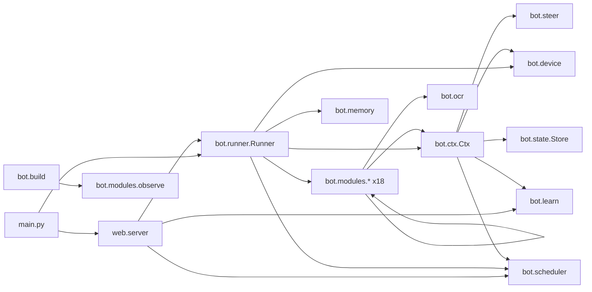
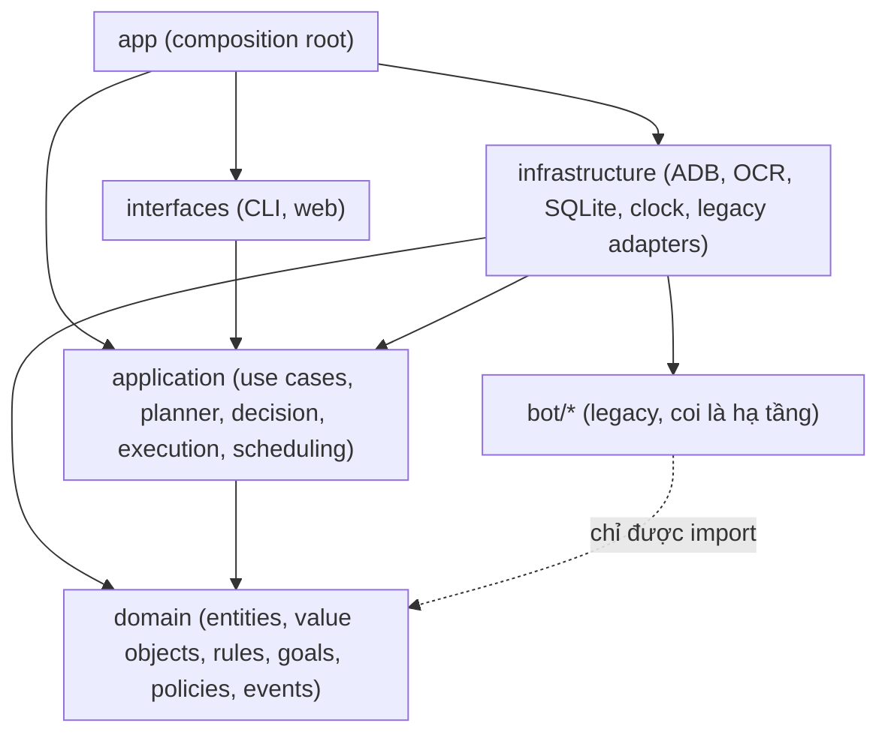
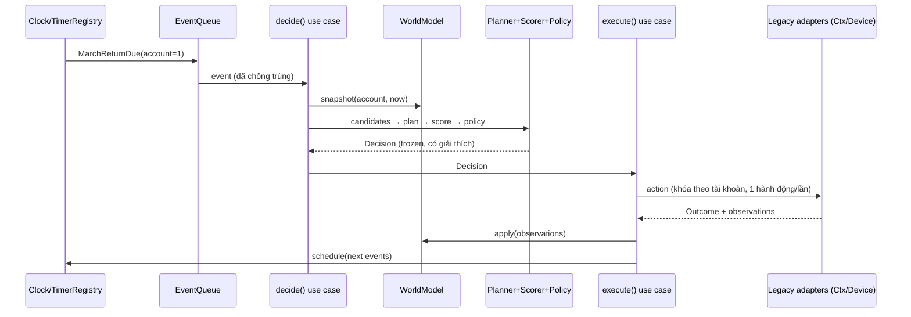

# Tổng quan hệ thống: hiện trạng và kiến trúc đích

Ngày: 2026-11-21 · Trạng thái: **Đề xuất, chờ chủ dự án duyệt** (ADR-0012) · Không có thay đổi cấu trúc nào được áp dụng.

Tài liệu cùng bộ:
- [code-organization.md](code-organization.md): cây thư mục đích, bản đồ trách nhiệm, bản đồ migration
- [dependency-rules.md](dependency-rules.md): luật phụ thuộc và cách kiểm tra tự động
- [module-contracts.md](module-contracts.md): hợp đồng các port và hợp đồng từng module cũ
- [testing-strategy.md](testing-strategy.md): chiến lược test, công cụ, CI
- ADR liên quan: [0013](../adr/0013-modular-monolith-phan-lop-src-aowbot.md), [0014](../adr/0014-luat-phu-thuoc-kiem-tra-tu-dong.md), [0015](../adr/0015-cong-cu-chat-luong-va-ci.md)
- Audit hành vi và hiệu năng: [docs/strategy/phase-0-audit.md](../strategy/phase-0-audit.md)

Nhãn bằng chứng: **[MEASURED]** đo bằng phân tích AST, chạy script hoặc đọc DB · **[OBSERVED]** đọc thấy trong code · **[INFERRED]** suy luận.

---

## 1. Hiện trạng kiến trúc

### 1.1 Hình dạng hệ thống [MEASURED]
- 51 file Python, 9.176 dòng: `bot/` (19 file lõi), `bot/modules/` (19 bước), `web/`, `tools/`, `main.py`.
- Không có `pyproject.toml`. `requirements.txt` gồm 5 gói runtime. Không có test framework, linter hay type checker.
- Repo đã là git (remote `origin`), nhưng `tests/fixtures/` (97 MB ảnh) và `data/` bị `.gitignore`.
- Có 2 script hồi quy offline, đang **pass**: `tools/check_screens.py` **13/13** (189 ms/ảnh), `tools/check_tutorial.py` **34/34**.

### 1.2 Vấn đề kiến trúc (xếp theo mức ảnh hưởng tới khả năng phát triển agent)

| # | Vấn đề | Bằng chứng |
|---|---|---|
| P1 | **Runner là god class:** vòng đời VM, mở game, cổng nghiệp vụ (research < HQ8, rebels, world), phòng thủ, theo hướng dẫn, flush học máy, backoff, watchdog, chép facts | [MEASURED] `Runner` 420 dòng; `run_account` 150 dòng, độ phức tạp vòng **52** |
| P2 | **Ctx là god class:** I/O thiết bị, vision, điều hướng, hook học máy, watchdog, OCR hành quân, nhận thưởng, **chính sách VIP** (luật nghiệp vụ nằm trong lớp hạ tầng) | [MEASURED] `Ctx` 596 dòng; `goto` độ phức tạp 30 · [OBSERVED] `claim_loop` có nhánh `use_vip_items` |
| P3 | **Luật nghiệp vụ rải rác ở 4 nơi:** ngưỡng nhà chính 6/8/9/15 nằm ở `scheduler`, cổng trong `run_account`, đầu `gather.run`, `rebels_ready` | [OBSERVED] |
| P4 | **Hai kho trạng thái chồng nhau, không rõ ai sở hữu:** `state.json` và `memory.db.facts`; `hq_level` có 3 nguồn ghi, dẫn tới lỗi làm tươi dữ liệu cũ | [OBSERVED] phase-0-audit §1.6 |
| P5 | **Module gọi chéo nhau:** `reddots` → 6 module; `defense` → `gather`; `mainquest`/`quests` → `tutorial`; `runner` → `quests._battle_blocked` (hàm riêng); `build` (lõi) → `modules.observe` (đảo tầng) | [MEASURED] đồ thị import |
| P6 | **Trạng thái global ẩn:** `learn._inst` (singleton), `steer._battle_owner/_battle_cv/active_serials`, `screens._tl` (kênh trả kết quả ngầm `last_detail()`), `ocr._ok`, `Vision.miss_hits` (runner đếm để suy ra "thiếu ảnh mẫu") | [MEASURED] AST |
| P7 | **Hợp đồng ngầm:** `run(ctx)` trả `int` với nghĩa khác nhau ở mỗi module; kết quả bước được suy từ số ảnh debug | [OBSERVED] module-contracts §3 |
| P8 | **Xử lý lỗi rộng:** 57 `except Exception/BaseException/bare`, **25 im lặng** (`pass`/`continue`/`return`); nhiều nhất ở `runner` (11), `memory` (7), `ctx` (6) | [MEASURED] AST |
| P9 | **48 import trong thân hàm** để né vòng import hoặc trì hoãn nạp, làm phụ thuộc bị ẩn | [MEASURED] AST |
| P10 | **Comment thay cho code/test:** nhiều luật "chủ dự án 2026-11-xx" chỉ tồn tại trong comment. Tài liệu và code đã lệch: `reddots` "cuối lượt" nhưng đứng thứ 3 trong `ORDER`; CLAUDE.md ghi "chưa phải git repo" | [OBSERVED] |
| P11 | **Lớp giao diện chứa logic:** `web.server` tự tính `rebels_done_today`, đọc thẳng `mem`, gọi `learn.promote` (ghi ảnh mẫu) | [OBSERVED] |
| P12 | **Runtime ghi vào cây mã nguồn:** `learn.promote` ghi `templates/**/*@auto*.png`; đường dẫn `logs/` tính theo CWD | [OBSERVED] |
| P13 | **Độ phức tạp:** 31 hàm > 40 dòng, 72 hàm có độ phức tạp vòng > 10 (`tutorial.decide` 117, `create_app` 49, `steer.detect` 47); 4 file > 400 dòng (`tutorial` 837, `notify` 639, `ctx` 608, `runner` 472) | [MEASURED] AST |

Điểm tốt nên giữ [OBSERVED]:
- Có sẵn nhiều **hàm thuần** test được offline: `scheduler.*`, `tutorial.decide` (ADR-0011), `learn.outcome/feat`, `gather.plausible`, `observe.parse_dur`, `ocr.amount/seconds`.
- `memory.db` có nhật ký đầy đủ (`runs`, `exp`, `nav`).
- Watchdog `Stuck(BaseException)` rõ ràng.
- Không có vòng import độ dài 2 [MEASURED].

---

## 2. Kiến trúc đích

### 2.1 Phong cách
**Modular monolith** một tiến trình, phân lớp theo **Ports & Adapters**. Bên trong từng lớp tổ chức theo bounded context (`account`, `marches`, `construction`…). **Dependency injection tường minh** tại một composition root. Composition thay cho kế thừa. Không có microservice: [MEASURED] chi phí quyết định (~0,1 s) nhỏ hơn 3 bậc so với chi phí bật VM (~75 s), nên không có lý do phân tán.

### 2.2 Lớp và hướng phụ thuộc

- `application` chỉ biết **port** (Protocol) do chính nó khai báo. `infrastructure` hiện thực các port đó.
- `bot/*` được coi là **hạ tầng cũ**. Chỉ `aowbot.infrastructure.legacy` được import `bot`. `bot` chỉ được import `aowbot.domain` (khi tách hàm thuần sang domain), không bao giờ import `application`/`infrastructure`/`app`.

### 2.3 Vòng quyết định đích (agent, các phase sau)

### 2.4 Nguyên tắc vận hành giữ nguyên
- ADR-0008 (kim cương), ADR-0010 (dữ liệu tài khoản), `max_running = 2`, ADR-0012 (từng phase).
- Runner cũ vẫn chạy song song và là đường dự phòng (`schedule.mode`) cho tới khi agent được chứng minh tốt hơn.

---

## 3. Rủi ro kiến trúc

| # | Rủi ro | Giảm thiểu |
|---|---|---|
| A1 | Thời kỳ song song: hai nơi chứa cùng một luật (bot cũ + domain mới) | Luật mới chỉ viết ở `domain`; `bot` import lại từ domain khi tách. Không sao chép |
| A2 | Adapter bọc `Ctx` (god class) bị rò rỉ: application vô tình phụ thuộc vào hành vi ngầm | Port hẹp theo use case (`MarchReader`, `GatherDispatcher`) thay vì một port "Ctx" rộng |
| A3 | Fixture ảnh không nằm trong git nên CI không chạy được hồi quy ảnh | Quyết định riêng (testing-strategy §5): commit tập con nhỏ đã duyệt, hoặc chỉ chạy local |
| A4 | Lint/type bật trên cả mã cũ gây hàng nghìn lỗi và sửa hàng loạt | Phạm vi nghiêm chỉ áp cho `src/aowbot`; `bot/` chỉ kiểm lỗi cú pháp/tên chưa định nghĩa |
| A5 | Quá thiết kế: tạo thư mục/Protocol không có người dùng | Luật "không có consumer thì không tạo"; cây đích chỉ là bản đồ, tạo dần theo lát dọc |
| A6 | Đa luồng + SQLite + `Store` global lock | Repository mới dùng kết nối theo luồng như `Memory`, ghi theo lô; không chia sẻ đối tượng có thể thay đổi giữa các luồng |
| A7 | `sys.path.insert` trong `tools/` và `main.py` | `pyproject.toml` + cài editable; giữ tương thích `python main.py` |
| A8 | Quy ước ngôn ngữ comment (CLAUDE.md: tiếng Việt không dấu) và yêu cầu "comment chỉ giải thích VÌ SAO" | Giữ cả hai: viết ít comment, ngôn ngữ theo CLAUDE.md (code-organization §5) |
